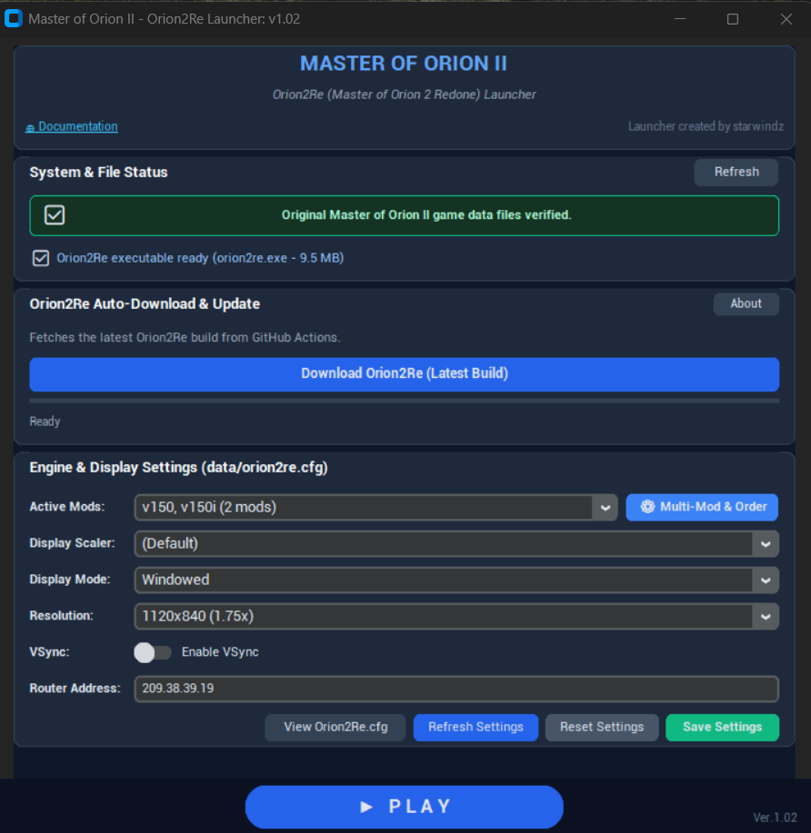
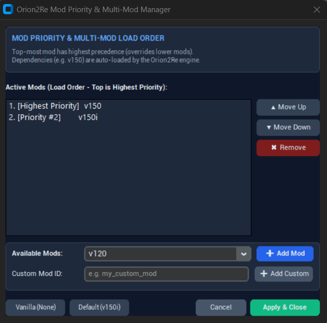

# Orion2Re (Master of Orion 2 Redone) Launcher

A modern, dark-themed Python launcher for **Orion2Re** (Master of Orion II Redone Engine) that simplifies downloading, configuring, and playing Master of Orion II.

<p align="center">
  
</p>

---

## Features

Orion2Re Launcher provides an all-in-one graphical toolkit to download the modern engine, configure visual and network preferences, manage multiple mods with customizable load priority order, and launch Master of Orion II seamlessly.

1. **Modern Dark Theme Interface**
   - Built with `customtkinter` featuring a clean dark aesthetic tailored for a modern gaming experience.
   - Sized compactly (~800px height) so the **PLAY** button is immediately visible without scrolling.

2. **Original MOO2 Asset Verification**
   - Automatically verifies that original Master of Orion II game data is present in the root folder (tested via game binary existence).
   - Displays a prominent status card with a warning banner if game files are missing, without exposing raw executable names to users.

3. **Orion2Re Automated Downloader & Updater**
   - **About Orion2Re**: **Orion2Re** (Master of Orion II Redone) is an open-source engine reimplementation and modern source port for the legendary 4X strategy classic *Master of Orion II: Battle at Antares*. The official source code repository is hosted on GitHub at [orion2re/orion2re](https://github.com/orion2re/orion2re), with technical documentation available at the [Orion2Re Documentation](https://moo2mod.com/redone/doc/index.html).
   - **Special Thanks**: Our deepest gratitude to the creators, developers, and contributors of the **Orion2Re** project for their tireless dedication, incredible reverse-engineering achievements, and passion in preserving and revitalizing Master of Orion II for modern hardware and systems.
   - **Automated Discovery**: Automatically inspects the latest successful build from the [starwindz/build_orion2re GitHub Actions workflow](https://github.com/starwindz/build_orion2re/actions/workflows/build.yml), which is forked from the build action at [Ajaja/build_orion2re](https://github.com/Ajaja/build_orion2re/actions/workflows/build.yml). Special thanks to **Ajaja** for creating and providing this automated build action!
   - **One-Click Installation**: Streams the latest release artifact and unpacks it directly into the project root directory with real-time progress percentage and byte transfer rate display. User-configured active mods and settings are preserved across updates.

4. **Multi-Mod Management & Priority Load Ordering**
   - **Multiple Mod Activation**: Enable multiple mods or add-on packages simultaneously rather than being restricted to a single choice.
   - **Priority Order Control**: Interactive **Mod Priority & Multi-Mod Manager** dialog with dedicated **Move Up (▲)** and **Move Down (▼)** controls. In alignment with Orion2Re's VFS architecture, the top-most mod takes the highest precedence and overrides lower mods, while required dependencies (such as `v150`) are automatically activated by the engine.
   - **Discovered & Custom Mods**: Automatically lists installed mods from `data/mods/` with an option to register custom mod identifiers on demand.
   - **Quick Selector & Presets**: Instant quick combobox for 1-click single mod or vanilla switching, plus default presets (`v150i`, Vanilla).

   <p align="center">
     
   </p>

5. **`data/orion2re.cfg` Visual Configuration Editor**
   - Load, modify, and save engine settings easily via UI combo boxes and toggle switches:
     - **Active Mods**: View current mod combinations or open the multi-mod priority organizer.
     - **Display Scaler**: `(Default)`, `hq2x`.
     - **Display Mode**: `Windowed` or `Fullscreen`.
     - **Resolution**: `640x480 (1x)`, `960x720 (1.5x)`, `1120x840 (1.75x)`, `1280x960 (2x)`, `1440x1080 (2.25x)`, `1920x1080 (FHD)`, etc.
     - **VSync**: Enable or disable vertical synchronization.
     - **Multiplayer Router IP**: Configure community router (`209.38.39.19`).
   - Action Buttons:
     - `Save Settings`: Writes settings to `data/orion2re.cfg`.
     - `Reset Settings`: Resets settings back to recommended defaults.
     - `Refresh Settings`: Reloads configuration from disk into the UI.
     - `View Orion2Re.cfg`: Opens the configuration file directly in the system text editor.
   - Generates clean, strictly validated syntax (semicolon-terminated statements) compatible with the Orion2Re configuration parser.

6. **Synchronous Game Launch (Play Button)**
   - Located at the center bottom for immediate access (automatically saves configuration before launching).
   - Automatically minimizes the launcher before starting the game.
   - Launches `orion2re.exe` synchronously and waits for execution to complete.
   - Automatically restores and focuses the launcher window when the game exits.

7. **Repository Cleanliness via `.gitignore`**
   - Strictly ignores all original game binaries, assets, and folders (`orion2/`, `data/`, `*.exe`, `*.lbx`, etc.), ensuring only Python launcher files and configurations are tracked in git.

---

## Project Structure

```
orion2re-launcher/
├── .gitignore            # Ignores all game files and binaries
├── config_manager.py     # data/orion2re.cfg configuration parser and mod scanner
├── downloader.py         # GitHub Actions build inspector and downloader
├── build.bat             # Standalone EXE builder (generates launcher.exe)
├── launcher.bat          # Windows one-click batch launcher (runs without console window)
├── launcher.exe          # Standalone binary (generated via build.bat, runs without Python)
├── launcher.py           # CustomTkinter dark-theme GUI application
├── main.py               # Application entry point
├── main.pyw              # Console-less GUI entry point for Windows
├── requirements.txt      # Python dependencies (customtkinter)
├── test_launcher.py      # Automated unit tests
├── screenshots/          # Application screenshots for documentation
│   ├── launcher_main.png
│   └── mod_manager.png
└── README.md             # Project documentation
```

---

## Getting Started

> [!IMPORTANT]
> **Setup**: Please copy `launcher.exe` into the folder where your original Master of Orion II game files are installed. After launching the application, click the **"Download Orion2Re"** button to automatically download and install the latest engine build (if the launcher has never been run before, the download will begin automatically upon launch).

### Option 1: Standalone Executable (No Python Required)
Run `build.bat` once to compile `launcher.exe`. You can then copy and launch `launcher.exe` directly in your original Master of Orion II folder on any Windows PC even without Python installed.

### Option 2: One-Click Run (Windows)
Double-click `launcher.bat`. It will automatically check dependencies and start the launcher.

### Option 3: Command Line
```bash
# 1. Install dependencies
pip install -r requirements.txt

# 2. Run the launcher
python main.py
```

---

## Author

Developed by **starwindz** ([GitHub](https://github.com/starwindz)).

---

## License

This project is licensed under the **GNU General Public License v3.0 (GPL-3.0)**.

See the [GNU General Public License](https://www.gnu.org/licenses/gpl-3.0.en.html) for full license details.

> **Disclaimer**: All rights to Master of Orion II, its assets, trademarks, and original data files belong to their respective copyright holders. This launcher project does not distribute original game data files. Users must provide their own legitimate copy of Master of Orion II.
